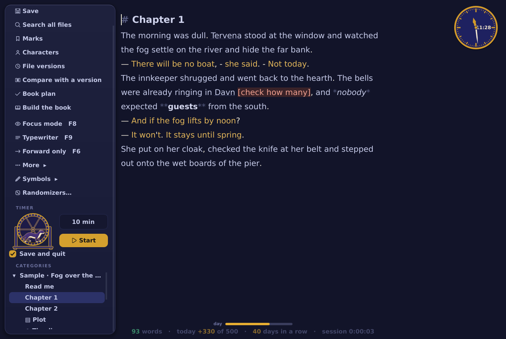
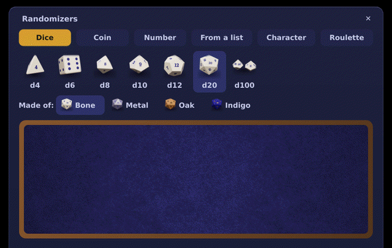
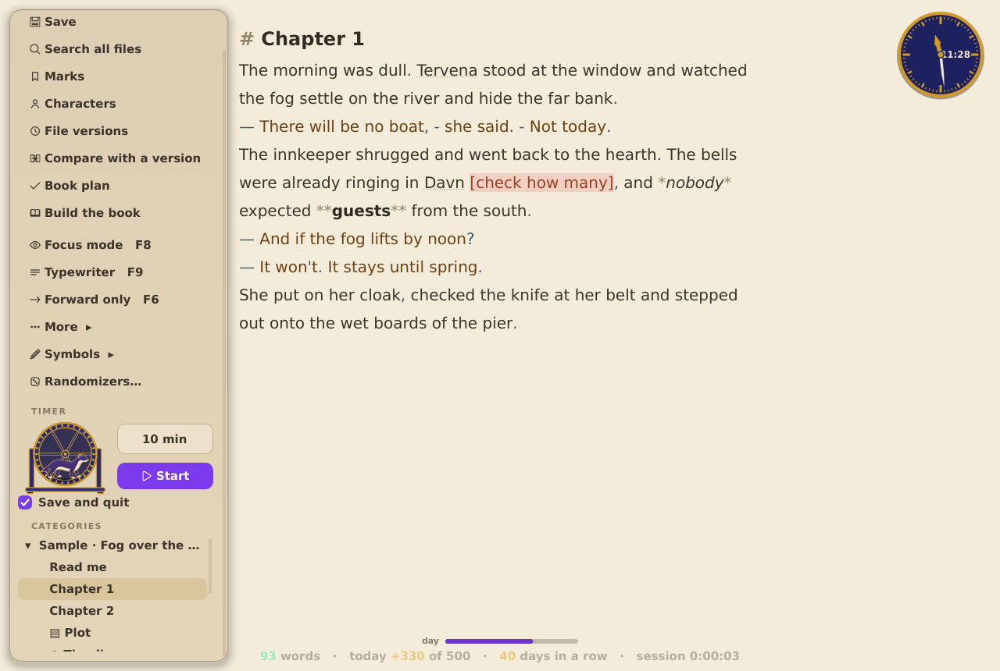
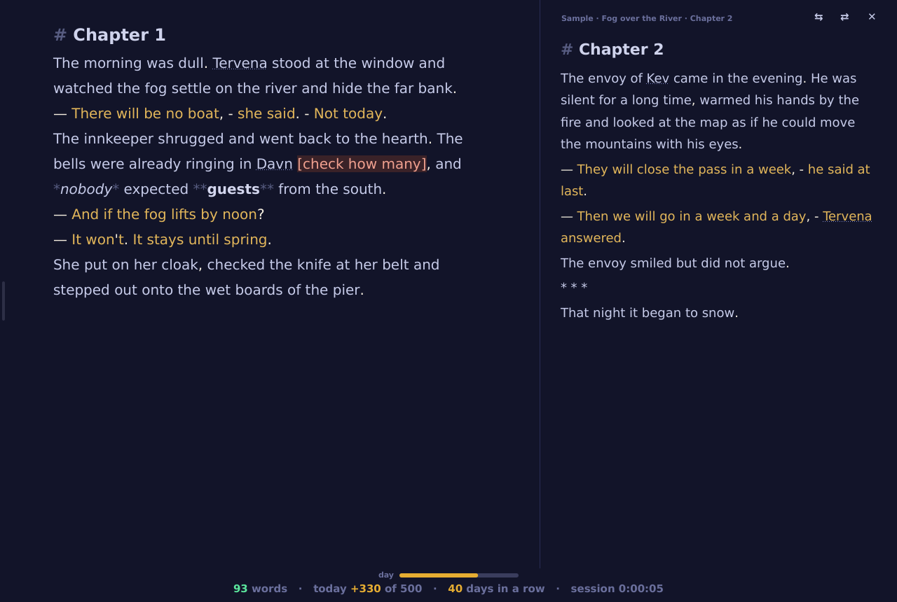
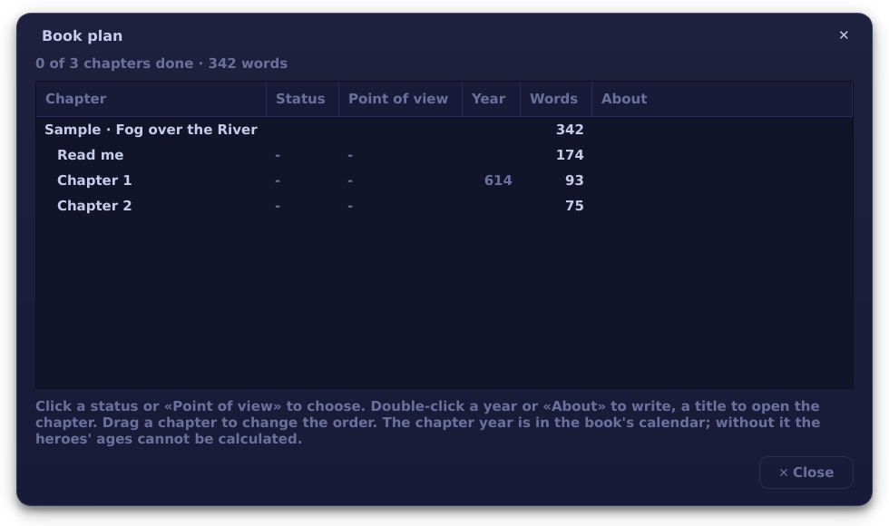
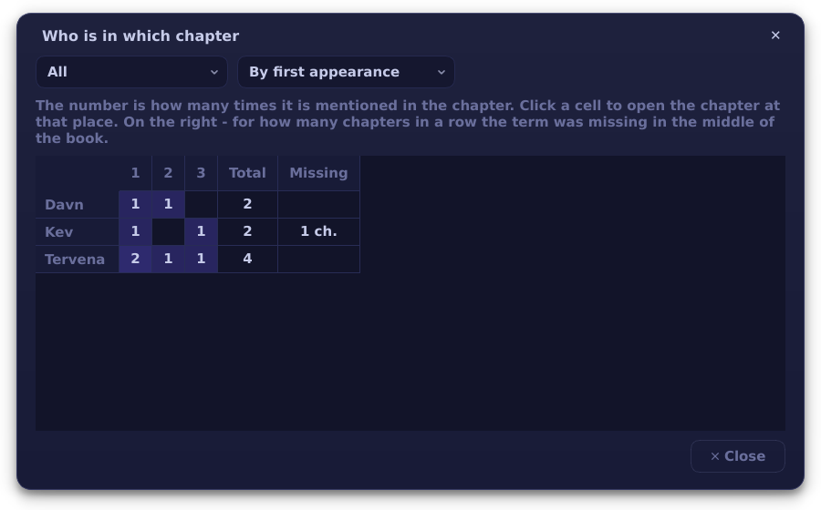
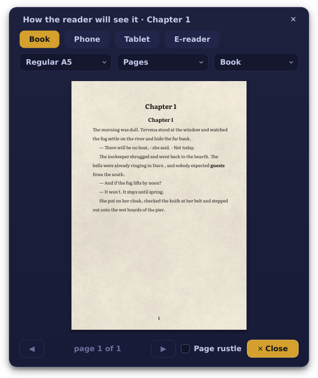
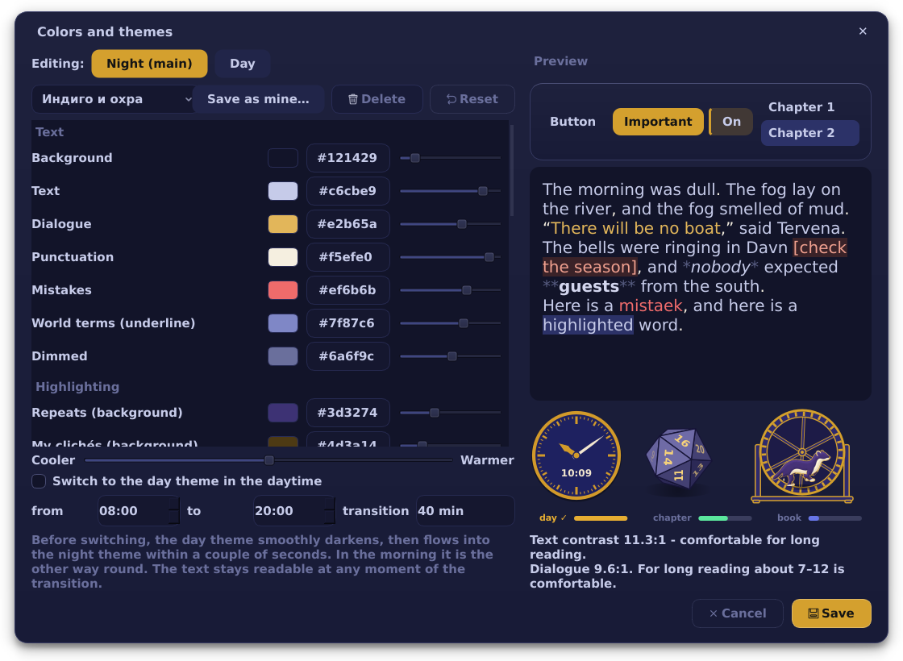
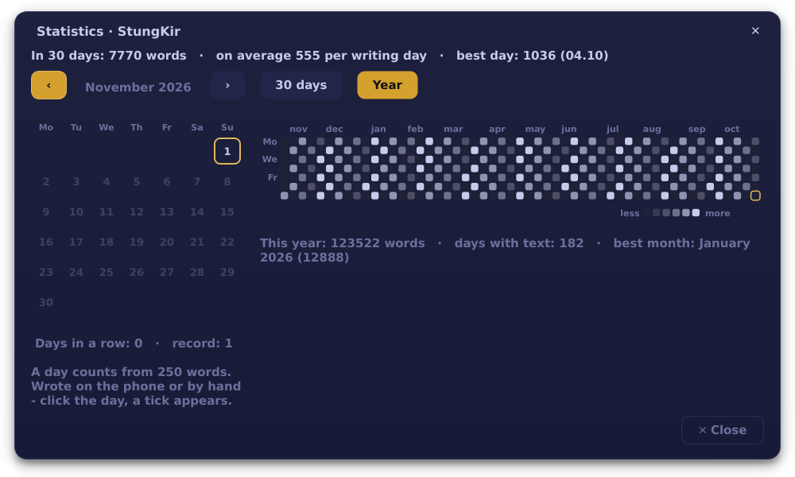
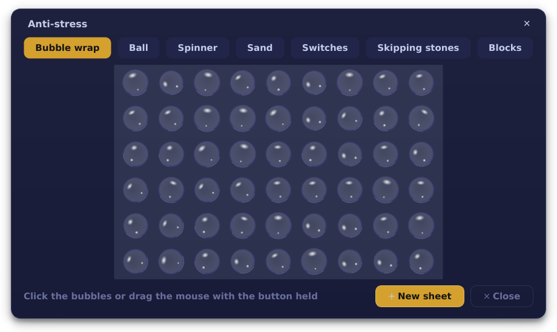

<p align="center"></p>

<p align="center">
<a href="https://github.com/KiriFestung/StungKir-notepad/releases/tag/windows-latest"><b>Windows</b></a> ·
<a href="https://github.com/KiriFestung/StungKir-notepad/releases/tag/linux-latest"><b>Linux (Flatpak)</b></a> ·
<a href="https://github.com/KiriFestung/StungKir-notepad/releases/tag/android-latest"><b>Android</b></a> ·
<a href="CHANGELOG.md">Changelog (in Russian)</a> ·
<a href="README.md">Русский</a>
</p>

<p align="center">
<a href="https://github.com/KiriFestung/StungKir-notepad/actions/workflows/check.yml"></a>
<a href="https://github.com/KiriFestung/StungKir-notepad/actions/workflows/android.yml"></a>
<a href="LICENSE"></a>
</p>

A notepad for people who write books, not notes: chapters in folders, a world reference with hints right in the text, margin notes, a history of every chapter, and building the book as PDF, Word and EPUB. Your texts are plain `.txt` files in your own folder: no accounts, no cloud. The notepad goes online only if you press «Publish to the site» yourself. Phone: via Syncthing and the StungKir app for Android.

The interface comes in **English (US)**, **English (UK)** and **Russian** - pick one on the first start or later in Settings. English text gets its own care: dialogue in quotes is highlighted, spelling is checked with US or UK dictionaries, repeated words and your own clichés are found in every form (*looked*, *looks*, *looking*), and «Who speaks» understands *“No,” Kira said.*

> **Early version.** The notepad protects your text: autosave, chapter versions, daily backups, restore points. But it is young, and bugs are possible. Keep your own copies of important books for now: on a USB stick, in the cloud, or once a week with the «Weekly copy» setting. Found a bug? Write in [Issues](https://github.com/KiriFestung/StungKir-notepad/issues).



## Download

| Where | What to download | |
|---|---|---|
| **Windows 10 and 11** | [StungKir-Setup-1.2.0.exe](https://github.com/KiriFestung/StungKir-notepad/releases/download/windows-latest/StungKir-Setup-1.2.0.exe) | installer |
| **Windows, from a USB stick** | [StungKir-Windows-portable.zip](https://github.com/KiriFestung/StungKir-notepad/releases/download/windows-latest/StungKir-Windows-portable.zip) | no installation, no admin rights, texts stay on the stick |
| **Linux** | [StungKir.flatpak](https://github.com/KiriFestung/StungKir-notepad/releases/download/linux-latest/StungKir.flatpak) | any distribution |
| **Android** | [StungKir-Android.apk](https://github.com/KiriFestung/StungKir-notepad/releases/download/android-latest/StungKir-Android.apk) | writes to the same folder as the computer; the phone app is in Russian for now |

Builds update by themselves after every change and pass more than four hundred checks before release - on Linux and on Windows.

## What it can do

- **Write.** Chapters and categories are ordinary files; autosave; highlighting of dialogue, punctuation, repeated words, `[ ]` marks and spelling; focus, typewriter and «forward only» modes; daily and chapter goals, a streak of days in a row.
- **Remember the world.** A reference of names and terms with a hint on hover; who appears in which chapter; a story board on a corkboard with pins and threads; a timeline in your own calendar; presets for a bestiary, states, peoples, magic.
- **Edit.** Versions of every chapter and comparison next to the text; find and replace across all chapters; your own clichés; sentence rhythm; who speaks in long dialogues; reading aloud.
- **Not lose anything.** Restore points for the whole book, daily backups and a weekly copy to a USB stick, your own trash, a spare file of what you typed, a password for all texts.
- **Build the book.** PDF, Word, EPUB, FB2 and plain text from templates; a cover; «How the reader will see it» on an A5 page, a phone and an e-reader.
- **Take a useful break.** Dice d4-d100 on a table (bone, metal, oak, indigo), a coin, a roulette of writing challenges, a timer with a weasel in a wheel, anti-stress: bubble wrap, a sand garden, a key puzzle, skipping stones.
- **Look your way.** Ten themes, your own picture under the text, Literata and PT Serif fonts, your own hotkeys.

<p align="center"></p>

| | |
|---|---|
|  |  |
|  |  |
|  |  |
|  |  |

## Installation

### Windows 10 and 11

Download [StungKir-Setup-1.2.0.exe](https://github.com/KiriFestung/StungKir-notepad/releases/download/windows-latest/StungKir-Setup-1.2.0.exe) and run it. The installer asks for a language and passes your choice to the program. Dictionaries and fonts are inside. Windows may warn about an «unknown publisher» - the program is not signed with a paid certificate. Click «More info → Run anyway».

**From a USB stick, without installation or admin rights:** [StungKir-Windows-portable.zip](https://github.com/KiriFestung/StungKir-notepad/releases/download/windows-latest/StungKir-Windows-portable.zip) - unpack it on the stick and run `StungKir.exe`. Texts, backups and settings stay on the stick; nothing is left on someone else's computer.

### Linux (any distribution)

Download [StungKir.flatpak](https://github.com/KiriFestung/StungKir-notepad/releases/download/linux-latest/StungKir.flatpak) and install it:

```bash
flatpak remote-add --user --if-not-exists flathub https://flathub.org/repo/flathub.flatpakrepo
flatpak install --user StungKir.flatpak
flatpak run page.codeberg.kirifestung.StungKir
```

### Android

Download [StungKir-Android.apk](https://github.com/KiriFestung/StungKir-notepad/releases/download/android-latest/StungKir-Android.apk) right on the phone. How to install it and connect it to the computer - [docs/ТЕЛЕФОН.md](docs/ТЕЛЕФОН.md) (in Russian).

macOS is not officially supported.

## Where your data lives

| | Linux | Windows |
|---|---|---|
| Texts (only your categories) | `~/StungKir` | `C:\Users\<name>\StungKir` |
| Book service files: chapter versions, margin notes, statistics, your dictionary, trash, password key | `~/StungKir/.stungkir` (hidden) | `StungKir\.stungkir` (hidden) |
| Settings, backups, restore points, error log | `~/.local/share/stungkir` | `%APPDATA%\StungKir` |

Texts are plain `.txt` files: the folder can be copied and synced, for example with a phone via Syncthing. Service files live inside it and travel with the texts. Exact paths are in «More → About».

**Password.** When you set a password, the notepad shows a recovery code once - you can sign in with it if you forget the password. If you lose both the password and the code, nobody can recover the texts, not even the author of the program.

## For developers

**From source** (Python 3.11+, PySide6):

```bash
git clone https://github.com/KiriFestung/StungKir-notepad.git && cd StungKir-notepad
python3 -m stungkir            # run
python3 -m stungkir --test     # more than four hundred checks in a temporary folder, your texts are not touched
```

Or with pip in one command: `pipx install git+https://github.com/KiriFestung/StungKir-notepad.git`.

**Builds** run by themselves on GitHub Actions after every change: checks on Linux (two PySide versions) and on Windows, a Windows installer and portable version, Flatpak, an Android APK. Every night robots run too: a «monkey» clicks around the windows at random, a fuzzer feeds the notepad broken text. The code is split into folders in `stungkir/`: `core`, `text`, `world`, `story`, `books`, `fun`, `ui`; the map is at the top of `stungkir/__init__.py`. Code comments and most documentation are in Russian.

## License and authors

Copyright © 2026 KiriFesTung.

StungKir is free software under the [GNU GPL version 3 or later](LICENSE). You may use, study, change and share it; changed versions must stay under the GPL too.

Authors: **KiriFesTung** together with **Claude** (Anthropic) - see [AUTHORS.md](AUTHORS.md).

The Windows build and Flatpak include the DejaVu fonts (Bitstream Vera license) and Hunspell dictionaries: Russian by A. Lebedev (BSD), English US from SCOWL (permissive) and English UK (LGPL) - license texts are in `packaging/`. The program comes without warranty and sends nothing to the internet by itself (except «Publish to the site», by a button). Full list of third-party parts and their licenses - [docs/ПРАВОВОЕ.md](docs/ПРАВОВОЕ.md) (in Russian).
