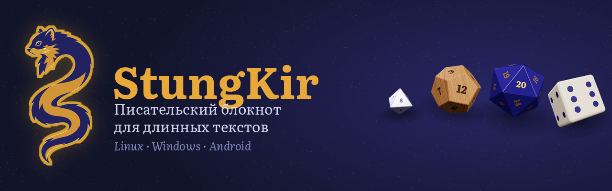
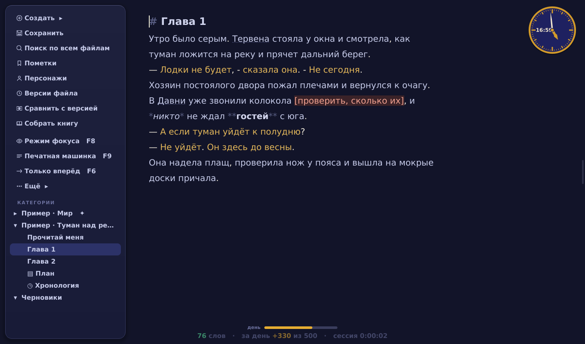
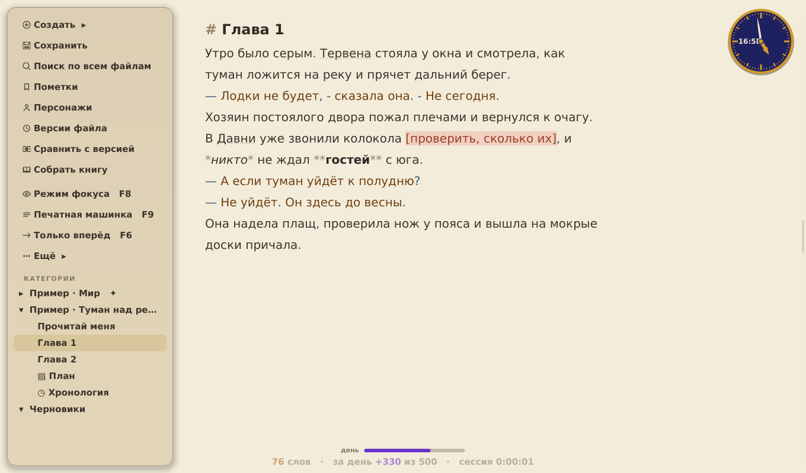
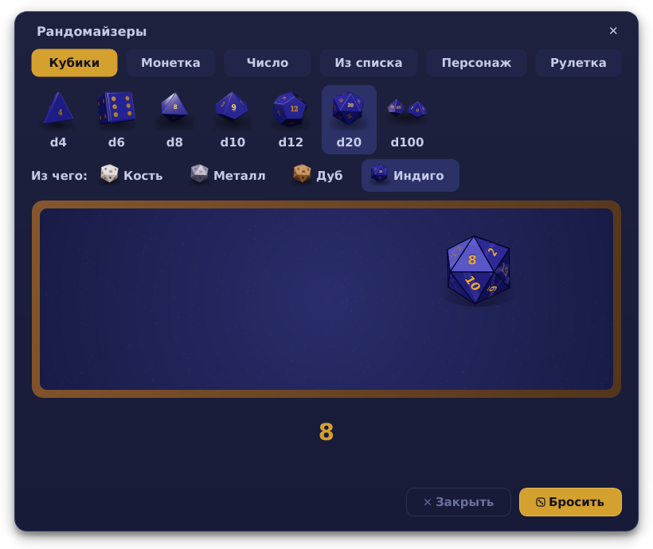
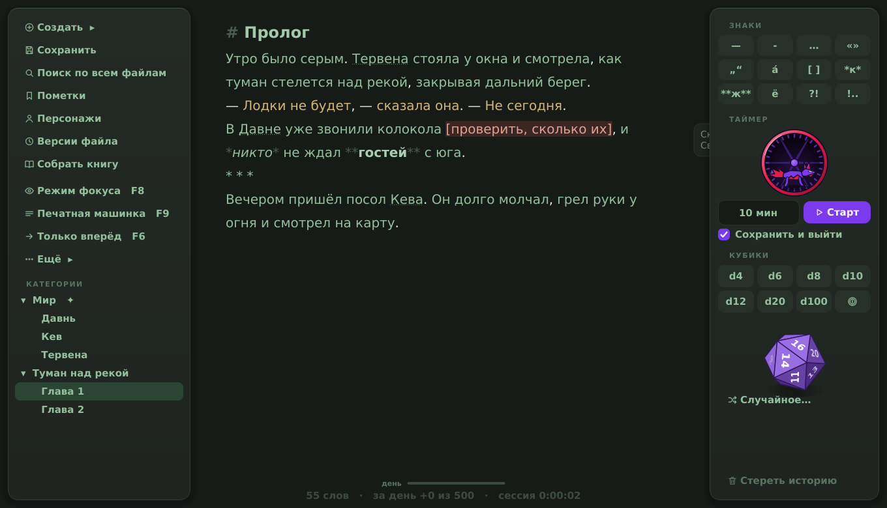
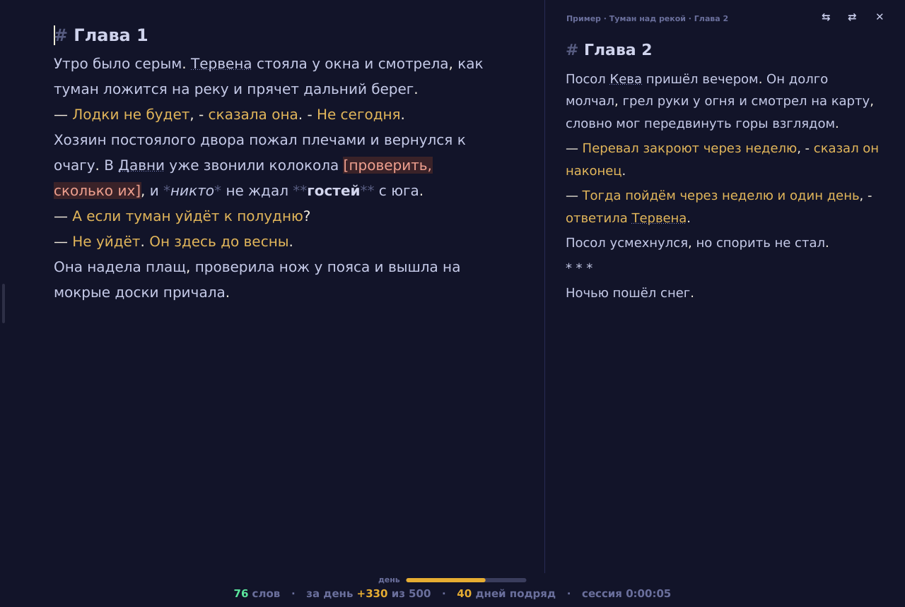

<p align="center"></p>

<p align="center">
<a href="https://github.com/KiriFestung/StungKir/releases/tag/windows-latest"><b>Windows</b></a> ·
<a href="https://github.com/KiriFestung/StungKir/releases/tag/linux-latest"><b>Linux (Flatpak)</b></a> ·
<a href="https://github.com/KiriFestung/StungKir/releases/tag/android-latest"><b>Android</b></a> ·
<a href="docs/РУКОВОДСТВО.md">Руководство</a> ·
<a href="CHANGELOG.md">Что нового</a>
</p>

Блокнот для тех, кто пишет книгу, а не заметки: главы по папкам, справочник мира с подсказками прямо в тексте, заметки на полях, версии каждой главы и сборка книги в PDF, Word и EPUB. Тексты - обычные `.txt` в твоей папке: без аккаунтов, облаков и интернета. С телефоном - через Syncthing и своё приложение для Android.



## Скачать

| Где | Что скачать | |
|---|---|---|
| **Windows 10 и 11** | [StungKir-Setup-1.0.0.exe](https://github.com/KiriFestung/StungKir/releases/download/windows-latest/StungKir-Setup-1.0.0.exe) | установщик |
| **Windows, с флешки** | [StungKir-Windows-portable.zip](https://github.com/KiriFestung/StungKir/releases/download/windows-latest/StungKir-Windows-portable.zip) | без установки и без прав администратора, тексты - на флешке |
| **Linux** | [StungKir.flatpak](https://github.com/KiriFestung/StungKir/releases/download/linux-latest/StungKir.flatpak) | любой дистрибутив; для Debian и Ubuntu есть ещё `install.sh` (ниже) |
| **Android** | [StungKir-Android.apk](https://github.com/KiriFestung/StungKir/releases/download/android-latest/StungKir-Android.apk) | пишет в ту же папку, что и компьютер; [как связать](docs/ТЕЛЕФОН.md) |

Сборки обновляются сами после каждого изменения и перед выкладкой проходят больше трёхсот проверок - и на Linux, и на Windows.

## Что умеет

- **Писать.** Главы и категории - обычные файлы; автосохранение; подсветка реплик, знаков, повторов, пометок `[ ]` и орфографии; режимы фокуса, печатной машинки и «только вперёд»; цели на день и на главу, серия дней подряд.
- **Помнить мир.** Справочник имён и терминов с подсказкой при наведении и падежами («Тервена», «Тервены», «Тервеной»); кто в какой главе; доска сюжета на пробке с булавками и нитками; хронология в своём летоисчислении; заготовки для бестиария, государств, народов, магии.
- **Править.** Версии каждой главы и сравнение рядом с текстом; найти и заменить во всех главах по всем падежам; свои слова-костыли; ритм предложений; кто говорит в длинных диалогах; чтение вслух.
- **Не потерять.** Точки возврата всей книги, резервные копии каждый день и раз в неделю на флешку, своя корзина, запасной файл набранного, пароль на все тексты.
- **Собрать книгу.** PDF, Word, EPUB, FB2 и текст по шаблонам - от рукописи для издательства до самиздата; обложка; «как увидит читатель» на странице A5, телефоне и читалке.
- **Отвлечься с пользой.** Кубики d4-d100 на столе для бросков (кость, металл, дуб, индиго), монетка «ворон или ласка», рулетка писательских вызовов, таймер с лаской в колесе, антистресс.
- **Выглядеть по-своему.** Десять тем (основная - индиго и охра, днём - светлая «бумага»), своя картинка под текстом, шрифты Literata и PT Serif, свои горячие клавиши.

| | |
|---|---|
|  |  |
|  |  |

<details>
<summary><b>Всё по пунктам</b></summary>

- **Главы и категории.** Каждая папка — категория, каждая глава — обычный `.txt`. Никакой базы данных: тексты открываются чем угодно и переживут сам блокнот.
- **Автосохранение.** Сохраняет на паузе в наборе (3 секунды) и не реже раза в 30 секунд, если печатаешь без остановки. Раз в 10 минут кладёт версию в историю главы.
- **Версии и сравнение.** История каждой главы, сравнение любых двух версий по словам, откат.
- **Справочник мира.** Имена и термины подсвечиваются в тексте, при наведении — заметка о них. Понимает падежи («Тервена», «Тервены», «Тервеной»). Проверка разного написания одного имени («Тервена» / «Тервенна»).
- **Мои штампы**: свой список слов-костылей с подсветкой в тексте, подсчётом по главам и заменой с просмотром каждого места.
- **Заметки на полях** к абзацам (Ctrl+M), не попадают в книгу.
- **Панель «рядом»** (F4): вторая глава или заметка из справочника для чтения сбоку.
- **Подсветка текста:** реплики, знаки препинания, повторы слов рядом, пометки `[ ]`, орфография.
- **Режимы:** фокус (гасит всё, кроме текущего абзаца), печатная машинка, «только вперёд», цели на день и на главу, статистика.
- **Сборка книги** в PDF, Word (.docx), EPUB, FB2 и текст, с шаблонами: обычная книга, рукопись для издательства, самиздат EPUB и FB2, книжный формат для печати.
- **Импорт** из Word (.docx), RTF и проектов Scrivener.
- **Импорт**: Word, LibreOffice, RTF, FB2, EPUB, HTML, Markdown, таблицы Excel и Calc, Scrivener. Вставка из буфера сама чинит пропавшие абзацы.
- **Заготовки для мира** одним нажатием: бестиарий, государства, народы, персонажи, места, магия, веры, языки, хронология.
- **Как увидит читатель**: глава на странице книги A5, на экране телефона и читалки.
- **Точки возврата** для всей книги и откат к ним; ежедневные резервные копии (14 дней) и копия раз в неделю в свою папку (флешка, облако); своя корзина на 30 дней.
- **Защита текста:** запасной файл набранного и восстановление после сбоя, страховка от случайного стирания, ошибки не закрывают окно, конфликты синхронизации с выбором версии.
- **Пароль** на все тексты (шифрование scrypt + Fernet) с кодом восстановления; смена пароля без перешифровки.
- **Вид:** десять готовых тем (основная - индиго и охра), своя картинка под текстом, обложки у категорий, свои горячие клавиши, свой цвет для всего — от текста до кубиков, колеса таймера и часов, свои темы, теплота, проверка контраста, дневная тема по расписанию; фон «бумага» или «лён»; шрифты Literata и PT Serif в комплекте; режим «Без отвлечений» (F10); часы, полоски целей и строку внизу можно убрать по отдельности; полоски — в цветах темы или радугой; часы и строку можно переставить.
- Таблицы, доска сюжета — колонками или **на пробке** с булавками и нитками, **хронология мира** в своём летоисчислении.
- Пример-проект при первом запуске — чтобы сразу было что потрогать.
- **Кто в какой главе**: персонажи и термины по главам — видно, кто надолго пропал. **Шаблоны карточек** справочника.
- **Найти и заменить во всех главах** с просмотром каждого места и заменой по всем падежам (переименовать персонажа).
- **Ритм главы** — график длины предложений. **Чтение вслух** (F5) с подсветкой предложения.
- **Дедлайн книги**: столько-то слов к дате — блокнот считает нужный темп.
- Календарь письма: дни подряд и рекорд.
- **Кто говорит**: длинные цепочки реплик без «сказала Кира» и непонятные «сказала она». **Реплики персонажей**: сколько говорит каждый — по книге и по главам.
- Таймер с лаской, бегущей в колесе, **объёмные кубики** d4–d100 со стуком по столу (d100 - двумя костями), монетка «ворон или ласка» со звоном (и иногда на ребро) и **«Рандомайзеры»**: стол для бросков с кубиками из кости, металла, дуба и смолы, монетка на стол, число, вариант из списка, персонаж или термин, рулетка со ста писательскими вызовами от безобидных до адища. Антистресс по F12: пупырка, мячик, спиннер, песок, тумблеры. Звук печатной машинки и напоминание дать отдых глазам - по желанию.
- Большие главы (сотни тысяч слов) открываются за пару секунд, смена темы — мгновенно.

</details>

Подробно обо всём — в [руководстве](docs/РУКОВОДСТВО.md).

## Установка

### Debian, Ubuntu и похожие

```bash
unzip StungKir.zip && cd StungKir
bash install.sh
```

Скрипт поставит системные пакеты (попросит пароль sudo), положит программу в `~/.local/share/stungkir` с собственным окружением Python, добавит ярлык в меню и прогонит самопроверку. Обновления системы его не ломают: если окружение испортится, оно пересоберётся при запуске.

### Flatpak (любой Linux)

Готовый `.flatpak` лежит в [релизах](https://github.com/KiriFestung/StungKir/releases/tag/linux-latest):

```bash
flatpak remote-add --user --if-not-exists flathub https://flathub.org/repo/flathub.flatpakrepo
flatpak install --user StungKir.flatpak
flatpak run page.codeberg.kirifestung.StungKir
```

Собрать самому: `flatpak-builder --user --install build packaging/flatpak/page.codeberg.kirifestung.StungKir.yml`.

### Windows 10 и 11

Скачать `StungKir-Setup-1.0.0.exe` из [релизов](https://github.com/KiriFestung/StungKir/releases/tag/windows-latest) и запустить. Словарь и шрифты уже внутри. Windows может предупредить «неизвестный издатель» — программа не подписана платным сертификатом; «Подробнее → Выполнить в любом случае».

Переносная версия для флешки (без установки и без прав администратора): `StungKir-Windows-portable.zip` - распаковать на флешку и запускать `StungKir.exe`. Пока рядом с ним лежит `portable.txt`, тексты, копии и настройки хранятся там же, на флешке, а на чужом компьютере ничего не остаётся.

Собрать установщик самому на Windows: `powershell -ExecutionPolicy Bypass -File packaging\windows\build-windows.ps1` (нужны Python 3.12 и Inno Setup 6). Без Windows — через GitHub, см. [docs/СБОРКА-WINDOWS.md](docs/СБОРКА-WINDOWS.md).

### Через pip

```bash
pipx install git+https://github.com/KiriFestung/StungKir.git
```

macOS официально не поддерживается.

## Где лежат данные

| | Linux | Windows |
|---|---|---|
| Тексты (только твои категории) | `~/StungKir` | `C:\Users\<имя>\StungKir` |
| Служебное книги: версии глав, заметки на полях, статистика, свой словарь, корзина, ключ пароля | `~/StungKir/.stungkir` (скрытая) | `StungKir\.stungkir` (скрытая) |
| Настройки, копии, точки возврата, журнал ошибок | `~/.local/share/stungkir` | `%APPDATA%\StungKir` |

Папку с текстами можно синхронизировать с телефоном через Syncthing: блокнот замечает изменения, сделанные снаружи. Для телефона есть своё приложение StungKir для Android, которое пишет прямо в эту папку - как поставить и связать, в [docs/ТЕЛЕФОН.md](docs/ТЕЛЕФОН.md). Служебное лежит внутри неё, поэтому синхронизируется вместе с текстами. В прошлых версиях служебные файлы лежали прямо в `StungKir` (`.stats.json`, `.versions` и т.п.) - при первом запуске они сами переезжают в `.stungkir`, перед этим делается резервная копия. Точные пути видны в «Ещё → О программе».

**Про пароль.** Когда ставишь пароль, блокнот один раз показывает код восстановления — им можно войти, если пароль забыт. Если потерять и пароль, и код, тексты не восстановить никак — ни автору программы, ни кому-то ещё.

## Самопроверка

```bash
stungkir --test              # после install.sh
python3 -m stungkir --test   # из папки с исходниками
```

Больше трёхсот автотестов: сохранение, кодировки, шифрование, справочник, сборка книги, импорт, цвета, автосохранение, кубики. Тесты работают во временной папке и не трогают ваши тексты и настройки. На GitHub они запускаются при каждом изменении кода - на Linux и на Windows.

## Лицензия и авторы

Copyright © 2026 KiriFesTung.

StungKir — свободная программа под лицензией [GNU GPL версии 3 или новее](LICENSE). Её можно использовать, изучать, менять и раздавать; изменённые версии тоже должны оставаться под GPL.

Авторы: **KiriFesTung** вместе с **Claude** (Anthropic) — см. [AUTHORS.md](AUTHORS.md).

Внутри Windows-сборки и Flatpak: шрифты DejaVu (свободная лицензия Bitstream Vera) и русский словарь Hunspell А. Лебедева (лицензия BSD) — тексты лицензий в `packaging/`.

Программа даётся без гарантий и ничего не отправляет в интернет. Полный список чужих частей и их лицензий, про данные и ответственность — [docs/ПРАВОВОЕ.md](docs/ПРАВОВОЕ.md).
