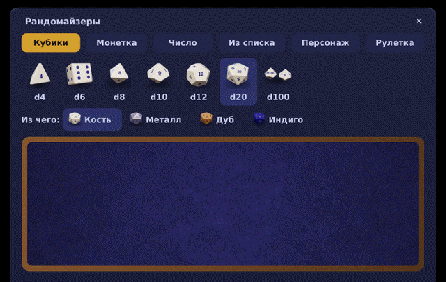
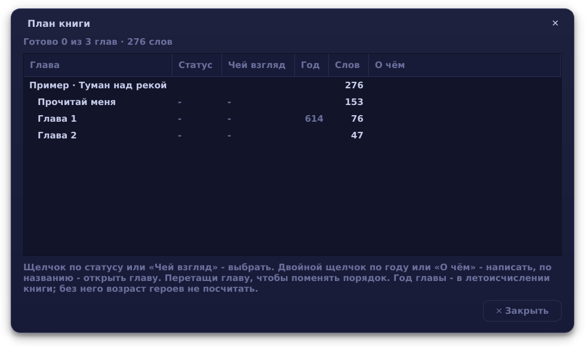
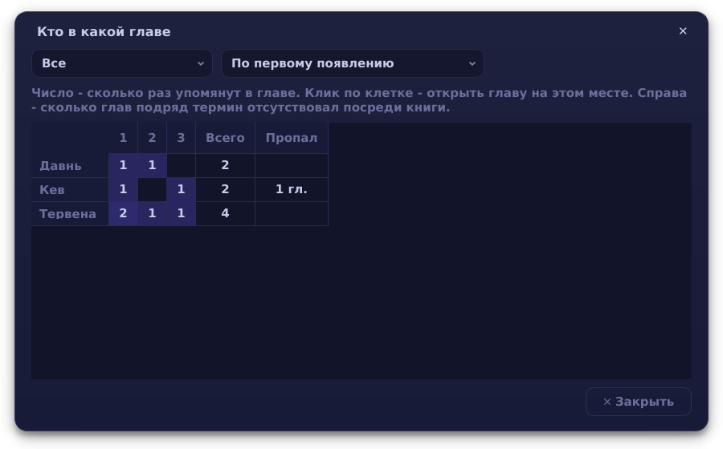
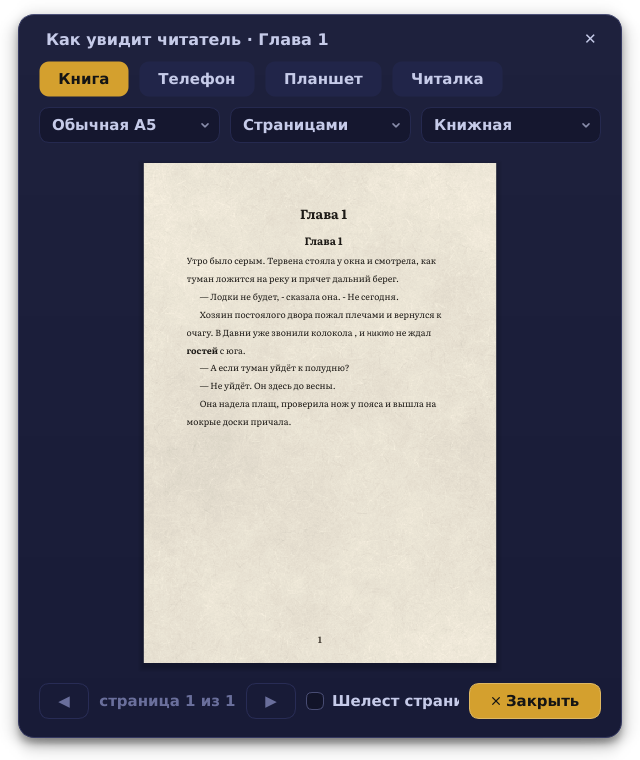
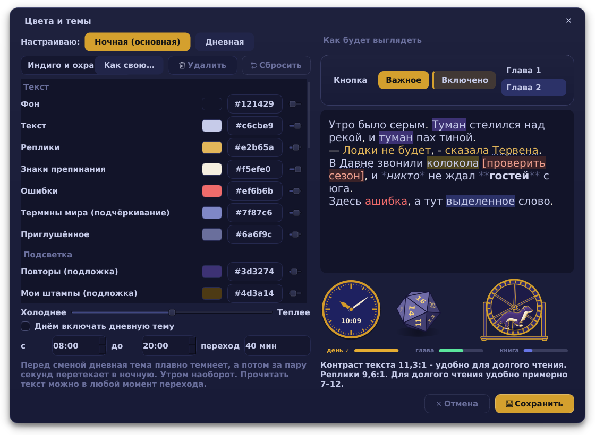
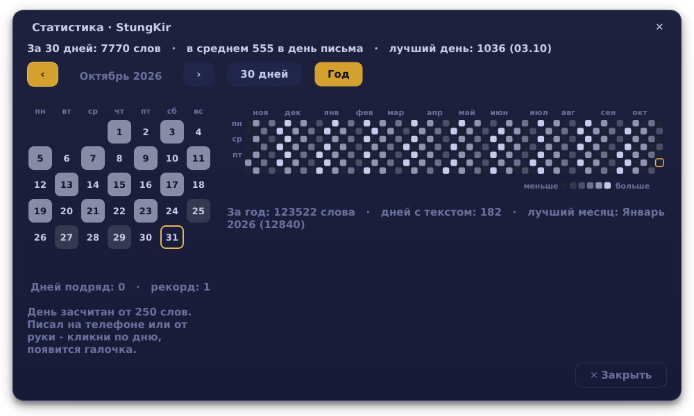
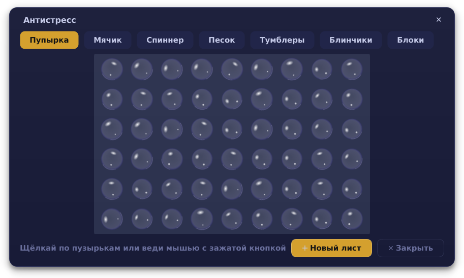

<p align="center"></p>

<p align="center">
<a href="https://github.com/KiriFestung/StungKir-notepad/releases/tag/windows-latest"><b>Windows</b></a> ·
<a href="https://github.com/KiriFestung/StungKir-notepad/releases/tag/linux-latest"><b>Linux (Flatpak)</b></a> ·
<a href="https://github.com/KiriFestung/StungKir-notepad/releases/tag/android-latest"><b>Android</b></a> ·
<a href="docs/РУКОВОДСТВО.md">Руководство</a> ·
<a href="CHANGELOG.md">Что нового</a>
</p>

<p align="center">
<a href="https://github.com/KiriFestung/StungKir-notepad/actions/workflows/check.yml"></a>
<a href="https://github.com/KiriFestung/StungKir-notepad/actions/workflows/android.yml"></a>
<a href="LICENSE"></a>
</p>

> **In English:** StungKir is a free notepad for writing long fiction - chapters as plain `.txt` files, a world reference with hover hints, margin notes, chapter history, and export to PDF, Word and EPUB. Works offline on Windows, Linux and Android. The interface is in Russian.

Блокнот для тех, кто пишет книгу, а не заметки: главы по папкам, справочник мира с подсказками прямо в тексте, заметки на полях, версии каждой главы и сборка книги в PDF, Word и EPUB. Тексты - обычные `.txt` в твоей папке: без аккаунтов и облаков; в интернет блокнот выходит, только если сам нажмёшь «Выложить на сайт». С телефоном - через Syncthing и своё приложение для Android.

> **Ранняя версия.** Блокнот бережёт текст: автосохранение, версии глав, ежедневные копии, точки возврата. Но программа молодая, и ошибки возможны. Пока делай свои копии важных книг: на флешку, в облако или раз в неделю кнопкой «Копия раз в неделю». Нашёл ошибку - напиши в [Issues](https://github.com/KiriFestung/StungKir-notepad/issues).


## Скачать

| Где | Что скачать | |
|---|---|---|
| **Windows 10 и 11** | [StungKir-Setup-1.0.0.exe](https://github.com/KiriFestung/StungKir-notepad/releases/download/windows-latest/StungKir-Setup-1.0.0.exe) | установщик |
| **Windows, с флешки** | [StungKir-Windows-portable.zip](https://github.com/KiriFestung/StungKir-notepad/releases/download/windows-latest/StungKir-Windows-portable.zip) | без установки и без прав администратора, тексты - на флешке |
| **Linux** | [StungKir.flatpak](https://github.com/KiriFestung/StungKir-notepad/releases/download/linux-latest/StungKir.flatpak) | любой дистрибутив; для Debian и Ubuntu есть ещё `install.sh` (ниже) |
| **Android** | [StungKir-Android.apk](https://github.com/KiriFestung/StungKir-notepad/releases/download/android-latest/StungKir-Android.apk) | пишет в ту же папку, что и компьютер; [как связать](docs/ТЕЛЕФОН.md) |

Сборки обновляются сами после каждого изменения и перед выкладкой проходят больше трёхсот проверок - и на Linux, и на Windows.

## Что умеет

- **Писать.** Главы и категории - обычные файлы; автосохранение; подсветка реплик, знаков, повторов, пометок `[ ]` и орфографии; режимы фокуса, печатной машинки и «только вперёд»; цели на день и на главу, серия дней подряд.
- **Помнить мир.** Справочник имён и терминов с подсказкой при наведении и падежами («Тервена», «Тервены», «Тервеной»); кто в какой главе; доска сюжета на пробке с булавками и нитками; хронология в своём летоисчислении; заготовки для бестиария, государств, народов, магии.
- **Править.** Версии каждой главы и сравнение рядом с текстом; найти и заменить во всех главах по всем падежам; свои слова-костыли; ритм предложений; кто говорит в длинных диалогах; чтение вслух.
- **Не потерять.** Точки возврата всей книги, резервные копии каждый день и раз в неделю на флешку, своя корзина, запасной файл набранного, пароль на все тексты.
- **Собрать книгу.** PDF, Word, EPUB, FB2 и текст по шаблонам - от рукописи для издательства до самиздата; обложка; «как увидит читатель» на странице A5, телефоне и читалке.
- **Отвлечься с пользой.** Кубики d4-d100 на столе для бросков (кость, металл, дуб, индиго), монетка «ворон или ласка», рулетка писательских вызовов, таймер с лаской в колесе, антистресс: пупырка, сад камней, головоломка из клавиш, блинчики по воде.
- **Выглядеть по-своему.** Десять тем (основная - индиго и охра, днём - светлая «бумага»), своя картинка под текстом, шрифты Literata и PT Serif, свои горячие клавиши.

<p align="center"></p>

| | |
|---|---|
|  |  |
|  |  |
|  |  |
|  |  |

<details>
<summary><b>Всё по пунктам</b></summary>

- **Главы и категории.** Каждая папка - категория, каждая глава - обычный `.txt`. Никакой базы данных: тексты открываются чем угодно и переживут сам блокнот.
- **Автосохранение.** Сохраняет на паузе в наборе (3 секунды) и не реже раза в 30 секунд, если печатаешь без остановки. Раз в 10 минут кладёт версию в историю главы.
- **Версии и сравнение.** История каждой главы, сравнение любых двух версий по словам, откат.
- **Справочник мира.** Имена и термины подсвечиваются в тексте, при наведении - заметка о них. Понимает падежи («Тервена», «Тервены», «Тервеной»). Проверка разного написания одного имени («Тервена» / «Тервенна»).
- **Мои штампы**: свой список слов-костылей с подсветкой в тексте, подсчётом по главам и заменой с просмотром каждого места.
- **Заметки на полях** к абзацам (Ctrl+M), не попадают в книгу.
- **Выложить на сайт:** правый клик по категории → «Выложить на сайт…» - главы со статусом «Готово» уходят в репозиторий своего сайта книг на GitHub одним изменением, сайт обновляется сам. Перед выкладкой видно, что добавится, обновится и уберётся.
- **Номера строк** слева от текста (Ctrl+L), как в обычном блокноте: номер у каждого абзаца.
- **План книги** (Ctrl+P): у главы статус («Идея», «Черновик», «Правка», «Готово»), чей взгляд, год в истории, «не в книгу» и пара строк о чём она; все главы таблицей со словами и итогом, порядок - перетаскиванием. Возраст героев в главе - по году рождения из справочника.
- **Панель «рядом»** (F4): вторая глава или заметка из справочника для чтения сбоку.
- **Подсветка текста:** реплики, знаки препинания, повторы слов рядом, пометки `[ ]`, орфография.
- **Режимы:** фокус (гасит всё, кроме текущего абзаца), печатная машинка, «только вперёд», цели на день и на главу, статистика.
- **Сборка книги** в PDF, Word (.docx), EPUB, FB2 и текст, с шаблонами: обычная книга, рукопись для издательства, самиздат EPUB и FB2, книжный формат для печати.
- **Импорт**: Word, LibreOffice, RTF, FB2, EPUB, HTML, Markdown, таблицы Excel и Calc, Scrivener. Вставка из буфера сама чинит пропавшие абзацы.
- **Заготовки для мира** одним нажатием: бестиарий, государства, народы, персонажи, места, магия, веры, языки, хронология.
- **Как увидит читатель**: глава на странице книги A5, на экране телефона и читалки.
- **Точки возврата** для всей книги и откат к ним; ежедневные резервные копии (14 дней) и копия раз в неделю в свою папку (флешка, облако); своя корзина на 30 дней.
- **Защита текста:** запасной файл набранного и восстановление после сбоя, страховка от случайного стирания, ошибки не закрывают окно, конфликты синхронизации с выбором версии.
- **Пароль** на все тексты (шифрование scrypt + Fernet) с кодом восстановления; смена пароля без перешифровки.
- **Вид:** десять готовых тем (основная - индиго и охра), своя картинка под текстом, обложки у категорий, свои горячие клавиши, свой цвет для всего - от текста до кубиков, колеса таймера и часов, свои темы, теплота, проверка контраста, дневная тема по расписанию; фон «бумага» или «лён»; шрифты Literata и PT Serif в комплекте; режим «Без отвлечений» (F10); часы, полоски целей и строку внизу можно убрать по отдельности; полоски - в цветах темы или радугой; часы и строку можно переставить.
- Таблицы, доска сюжета - колонками или **на пробке** с булавками и нитками, **хронология мира** в своём летоисчислении.
- Пример-проект при первом запуске - чтобы сразу было что потрогать.
- **Кто в какой главе**: персонажи и термины по главам - видно, кто надолго пропал. **Шаблоны карточек** справочника.
- **Найти и заменить во всех главах** с просмотром каждого места и заменой по всем падежам (переименовать персонажа).
- **Ритм главы** - график длины предложений. **Чтение вслух** (F5) с подсветкой предложения.
- **Дедлайн книги**: столько-то слов к дате - блокнот считает нужный темп.
- Календарь письма: дни подряд и рекорд.
- **Кто говорит**: длинные цепочки реплик без «сказала Кира» и непонятные «сказала она». **Реплики персонажей**: сколько говорит каждый - по книге и по главам.
- Таймер с лаской, бегущей в колесе, **объёмные кубики** d4–d100 со стуком по столу (d100 - двумя костями), монетка «ворон или ласка» со звоном (и иногда на ребро) и **«Рандомайзеры»**: стол для бросков с кубиками из кости, металла, дуба и индиго, монетка на стол, число, вариант из списка, персонаж или термин, рулетка со ста писательскими вызовами от безобидных до адища. Антистресс по F12: пупырка, мячик, спиннер, сад камней, тумблеры с головоломкой на сотни уровней, блинчики по воде. Звук печатной машинки и напоминание дать отдых глазам - по желанию.
- Большие главы (сотни тысяч слов) открываются за пару секунд, смена темы - мгновенно.

</details>

Подробно обо всём - в [руководстве](docs/РУКОВОДСТВО.md).

## Установка

### Windows 10 и 11

Скачать [StungKir-Setup-1.0.0.exe](https://github.com/KiriFestung/StungKir-notepad/releases/download/windows-latest/StungKir-Setup-1.0.0.exe) и запустить. Словарь и шрифты уже внутри. Windows может предупредить «неизвестный издатель»: программа не подписана платным сертификатом. Нажми «Подробнее → Выполнить в любом случае».

**С флешки, без установки и без прав администратора:** [StungKir-Windows-portable.zip](https://github.com/KiriFestung/StungKir-notepad/releases/download/windows-latest/StungKir-Windows-portable.zip) - распаковать на флешку и запускать `StungKir.exe`. Тексты, копии и настройки хранятся там же, на флешке, на чужом компьютере ничего не остаётся.

### Linux (любой дистрибутив)

Скачать [StungKir.flatpak](https://github.com/KiriFestung/StungKir-notepad/releases/download/linux-latest/StungKir.flatpak) и поставить:

```bash
flatpak remote-add --user --if-not-exists flathub https://flathub.org/repo/flathub.flatpakrepo
flatpak install --user StungKir.flatpak
flatpak run page.codeberg.kirifestung.StungKir
```

### Android

Скачать [StungKir-Android.apk](https://github.com/KiriFestung/StungKir-notepad/releases/download/android-latest/StungKir-Android.apk) прямо с телефона. Как поставить и связать с компьютером - [docs/ТЕЛЕФОН.md](docs/ТЕЛЕФОН.md).

macOS официально не поддерживается.

## Где лежат данные

| | Linux | Windows |
|---|---|---|
| Тексты (только твои категории) | `~/StungKir` | `C:\Users\<имя>\StungKir` |
| Служебное книги: версии глав, заметки на полях, статистика, свой словарь, корзина, ключ пароля | `~/StungKir/.stungkir` (скрытая) | `StungKir\.stungkir` (скрытая) |
| Настройки, копии, точки возврата, журнал ошибок | `~/.local/share/stungkir` | `%APPDATA%\StungKir` |

Тексты - обычные `.txt`: папку можно копировать и синхронизировать, например с телефоном через Syncthing ([как связать](docs/ТЕЛЕФОН.md)). Служебное лежит внутри неё и едет вместе с текстами. Точные пути - в «Ещё → О программе».

**Пароль.** Когда ставишь пароль, блокнот один раз показывает код восстановления - им можно войти, если пароль забыт. Если потерять и пароль, и код, тексты не восстановит никто, даже автор программы.

## Для разработчиков

**Из исходников** (Python 3.11+, PySide6):

```bash
git clone https://github.com/KiriFestung/StungKir-notepad.git && cd StungKir-notepad
python3 -m stungkir            # запуск
python3 -m stungkir --test     # больше трёхсот проверок во временной папке, тексты не трогают
```

Или одной командой через pip: `pipx install git+https://github.com/KiriFestung/StungKir-notepad.git`.

**Debian, Ubuntu и похожие** - `bash install.sh` из папки с исходниками: поставит системные пакеты (попросит пароль sudo), положит программу в `~/.local/share/stungkir` со своим окружением Python, добавит ярлык в меню и прогонит проверки. Обновления системы его не ломают: испорченное окружение пересоберётся при запуске.

**Сборки** собираются сами на GitHub Actions после каждого изменения: проверки на Linux (две версии PySide) и на Windows, установщик и переносная версия для Windows, Flatpak, APK для Android. Каждую ночь ещё и роботы: «обезьяна» жмёт по окну что попало, фаззер кормит блокнот битым текстом. Собрать самому:
- Flatpak: `flatpak-builder --user --install build packaging/flatpak/page.codeberg.kirifestung.StungKir.yml`;
- Windows: `powershell -ExecutionPolicy Bypass -File packaging\windows\build-windows.ps1` (нужны Python 3.12 и Inno Setup 6);
- Android: см. [docs/ТЕЛЕФОН.md](docs/ТЕЛЕФОН.md).

**Код** разложен по папкам в `stungkir/`: `core` - основа без окон (диск, настройки, защита текста), `text` - редактор и инструменты правки, `world` - справочник мира, `story` - план и доски, `books` - сборка, импорт и сайт, `fun` - кубики и антистресс, `ui` - окна. Подробная карта - в начале `stungkir/__init__.py`.

## Лицензия и авторы

Copyright © 2026 KiriFesTung.

StungKir - свободная программа под лицензией [GNU GPL версии 3 или новее](LICENSE). Её можно использовать, изучать, менять и раздавать; изменённые версии тоже должны оставаться под GPL.

Авторы: **KiriFesTung** вместе с **Claude** (Anthropic) - см. [AUTHORS.md](AUTHORS.md).

Внутри Windows-сборки и Flatpak: шрифты DejaVu (свободная лицензия Bitstream Vera) и русский словарь Hunspell А. Лебедева (лицензия BSD) - тексты лицензий в `packaging/`.

Программа даётся без гарантий и сама ничего не отправляет в интернет (кроме «Выложить на сайт», по кнопке). Полный список чужих частей и их лицензий, про данные и ответственность - [docs/ПРАВОВОЕ.md](docs/ПРАВОВОЕ.md).
